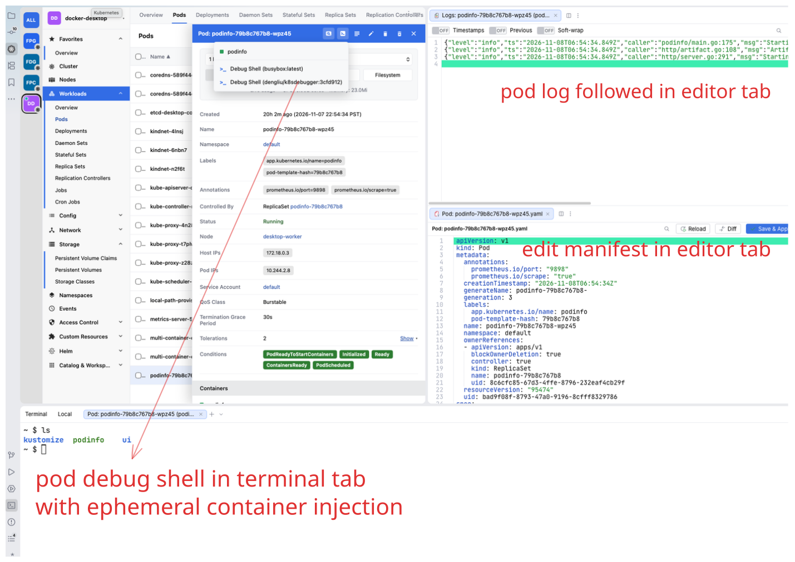
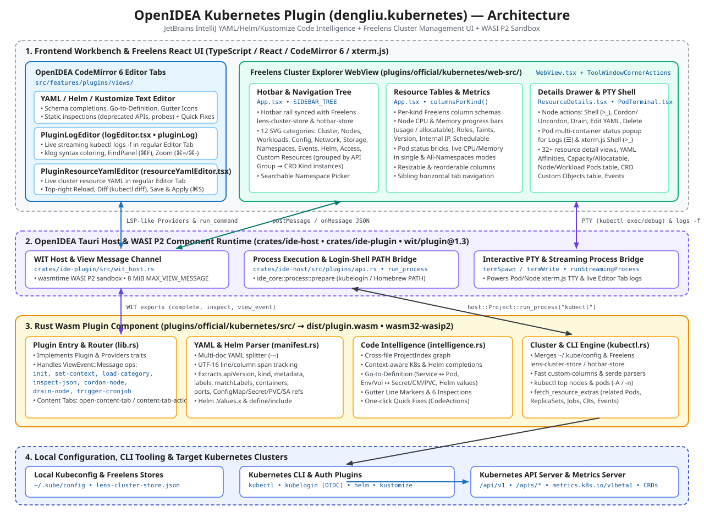

# Kubernetes for OpenIDEA

An [OpenIDEA](https://github.com/l0ng-ai/openidea) plugin (`dengliu.kubernetes`) that combines a [Freelens](https://github.com/freelensapp/freelens)-style Kubernetes cluster explorer with [JetBrains Kubernetes](https://plugins.jetbrains.com/plugin/10485-kubernetes)-style YAML, Helm, and Kustomize editor intelligence.



## Features

### 1. Freelens-Style Cluster Explorer (`web-src/`)
- **Multi-Cluster Hotbar & Catalog**: Automatically discovers contexts from `~/.kube/config` and Freelens cluster store metadata (`kubeconfig-sync` / `cluster-store.json`), with 1-click hotbar switching.
- **Multi-Namespace Picker, Auto-Scroll & Ground-Truth Cluster Search**: Select one, multiple, or all namespaces; stream virtualized scopes automatically (full load + live `watch=true` deltas for scopes ≤ 500 items, predictive scroll prefetch above 500 items); and search across 80k+ cluster resources via watch-cache Kubernetes `Table` streaming over a short-lived local `kubectl proxy`.
- **32+ Built-in Kubernetes Resource Kinds**:
  - **Cluster & Nodes**: Cluster Overview, Nodes (with live CPU/Memory progress bars from `kubectl top nodes`, Disk, Roles, Taints, Version, Internal IP, Age, Schedulable badge, Conditions, and Node Cordon/Uncordon/Drain/Shell actions), Namespaces, Events.
  - **Workloads**: Workloads Overview, Pods (with live CPU/Memory metrics from `kubectl top pods`, container status dots, QoS, Controlled By), Deployments, DaemonSets, StatefulSets, ReplicaSets, Jobs, CronJobs (Trigger & Suspend/Resume).
  - **Config & Network & Storage**: ConfigMaps, Secrets (inline base64 decode/reveal), ResourceQuotas, LimitRanges, HPAs, PDBs, PriorityClasses, RuntimeClasses, Leases, Mutating/Validating WebhookConfigurations, Services, Endpoints, EndpointSlices, Ingresses, IngressClasses, NetworkPolicies, PVCs, PVs, StorageClasses.
  - **Access Control (RBAC)**: ServiceAccounts, ClusterRoles, Roles, ClusterRoleBindings, RoleBindings.
  - **Custom Resources (CRD & CRs)**: Groups discovered CRDs by API Group in the sidebar (`CR:<crd_name>`) to browse Custom Resource instances directly, and lists Custom Objects inside the CRD details drawer.
  - **Helm Releases**: Lists installed Helm releases and revision metadata across namespaces.
- **Interactive Details Drawer**: Comprehensive Freelens-parity inspection drawer for all 32+ resource kinds, including Node `Capacity` & `Allocatable` (`GiB` conversion), collapsible YAML `Affinities` viewer (`<YamlCodeViewer>`), sortable `Pods` table with CPU/Memory progress bars, and resource `Events`.
- **Live Pod & Node Terminal (`xterm.js`), Log Tabs, and Resource YAML Tabs**:
  - Interactive `xterm.js` PTY shell for Pod containers (`kubectl exec -it`) and Nodes (`kubectl debug node/... -it --image=busybox`).
  - Streaming Pod log Editor Tabs (`kubectl logs --follow`) with container selector and toolbar toggles (`Timestamps`, `Previous`, `Wrap`, `Follow`).
  - Live Cluster Resource YAML Editor Tabs with `Reload`, `Diff` (`kubectl diff -f -`), and `Save & Apply` (`kubectl apply -f -`).

### 2. YAML, Helm & Kustomize Editor Intelligence (`src/`)
- **IntelliJ-Style Kubernetes, Helm & Kustomize File and Folder Icons**:
  - **Helm**: Automatically detects chart root folders (`Chart.yaml` / `Chart.yml` → folder with teal Helm wheel badge), chart metadata (`Chart.yaml`, `Chart.lock`, `requirements.yaml`, `helmfile.yaml` → table with Helm wheel badge), values files (`values.yaml`, `values-*.yaml`, `*.values.yaml`, `values.schema.json`, `ci/*.yaml` → lined document with Helm wheel badge), and chart templates (`templates/**`, `*.tpl`, `NOTES.txt`, `.helmignore`, and Go-templated YAML → hollow teal 8-spoke Helm wheel).
  - **Kustomize**: Automatically detects Kustomize overlay/base/component folders (`kustomization.yaml` / `kustomization.yml` / `Kustomization` → folder with purple Kustomize overlay badge), root kustomization/component manifests (`kustomize` icon), and referenced patches/plugins (`patches`, `patchesStrategicMerge`, `patchesJson6902`, `replacements`, `configurations`, `generators`, `transformers`, `validators`, RFC 6902 patch YAML, and `*.kustomize.config.k8s.io/*` → `kustomize-patch` icon).
  - **Kubernetes Manifests**: Marks YAML files containing `apiVersion` and `kind` (unless `# nonk8s` or owned by Helm/Kustomize patches) with the blue Kubernetes wheel icon.
- **Cross-Resource Navigation & Gutter Line Markers**: Navigate between `Service.spec.selector` ↔ `Deployment`/`StatefulSet`/`DaemonSet`/`Pod` labels, `envFrom`/`valueFrom` ↔ `ConfigMap`/`Secret` keys, `Ingress` ↔ backend `Service`, `PVC` ↔ `StorageClass`, and `RoleBinding` ↔ `Role`/`ServiceAccount`.
- **Context-Aware Completion & Live Templates**: Completes `apiVersion`, `kind`, target `ConfigMap`/`Secret`/`Service`/`StorageClass`/`ServiceAccount` names, data keys, and common container/probe/volume/securityContext fields, plus file templates (`Deployment`, `Service`, `ConfigMap`, `Ingress`, `Kustomization`).
- **8 Real-Time Manifest Inspections & Quick Fixes**:
  - `k8s-latest-tag`: Container image uses `:latest` or omits an explicit tag → Quick Fix pins `:1.0.0`.
  - `k8s-missing-resources`: Workload container omits `resources.limits`/`requests` → Quick Fix inserts CPU/memory requests & limits.
  - `k8s-missing-probes`: Workload container exposes ports without `livenessProbe`/`readinessProbe` → Quick Fix inserts HTTP readiness probe.
  - `k8s-privileged-container`: Container runs with `privileged: true` → Quick Fix sets `privileged: false`.
  - `k8s-missing-selector`: `Deployment`/`StatefulSet`/`DaemonSet` omits `spec.selector.matchLabels`.
  - `k8s-selector-mismatch`: Workload `spec.selector.matchLabels` does not match `spec.template.metadata.labels`.
  - `k8s-dangling-service-selector`: `Service` selector does not match any workload in the project.
  - `k8s-unresolved-ref`: Reference to a `ConfigMap`, `Secret`, `Service`, or key not found in the workspace.

## Architecture



See [design.md](./design.md) for the full architectural and protocol design.

## Capabilities

| Capability | Required / Optional | Why it is needed |
| --- | --- | --- |
| `process:kubectl` | Required | Queries cluster contexts, namespaces, resources, live watches, and metrics (`kubectl get`, `kubectl get --raw`, `kubectl top`, `kubectl describe`, `kubectl config view`), runs short-lived loopback `kubectl proxy` tunnels during cluster search, and executes user-initiated cluster actions (`apply`, `diff`, `delete`, `scale`, `rollout restart`, `cordon`, `uncordon`, `drain`, `port-forward`). |
| `net:127.0.0.1` | Required | Sends local loopback HTTP `GET` requests (`http://127.0.0.1:<port>/...`) to the ephemeral `kubectl proxy` process during ground-truth cluster search (`Accept: application/json;as=Table`) — never connects to external services directly. |
| `process:helm` | Optional | Lists Helm releases (`helm list -o json`) and renders chart templates (`helm template`). |
| `process:kustomize` | Optional | Builds Kustomize overlays (`kustomize build`) when previewing or inspecting overlays. |
| `project.read` | Required | Scans workspace YAML, Helm, and Kustomize files (`*.yaml`, `*.yml`, `Chart.yaml`, `kustomization.yaml`) to build the cross-resource manifest index and assign Project View file/folder icons. |
| `editor.read` | Required | Reads the active YAML editor buffer and cursor/selection for Go to Definition, completions, and manifest commands (`Apply`, `Diff`, `Dry Run`, `Delete`). |
| `editor.write` | Required | Applies quick-fix text edits to open YAML manifests. |
| `events` | Required | Subscribes to `file-opened`, `file-saved`, and path-filtered `files-changed` events to re-index workspace manifests, refresh diagnostics, and update file/folder icons automatically. |
| `storage` | Required | Persists the selected cluster context, namespace, `allNamespaces` toggle, and custom kubeconfig path across IDE restarts. |
| `clipboard` | Required | Copies resource names, `kubectl` commands, and rendered Helm/Kustomize output to the system clipboard. |

### Loopback Network Data Flow (`net:127.0.0.1` & `kubectl proxy`)

Ground-truth cluster search across large or partially loaded scopes uses `net:127.0.0.1` together with `process:kubectl` strictly over local loopback:

1. **Ephemeral loopback proxy**: When a cluster search runs, the plugin starts `kubectl proxy --port=0 --address=127.0.0.1` using the user's selected kubeconfig and cluster context. The OS assigns an ephemeral port bound exclusively to `127.0.0.1`.
2. **Read-only `Table` requests via selected context**: The OpenIDEA host sends read-only Kubernetes `Table` `GET` requests (`Accept: application/json;as=Table`, `?resourceVersion=0&includeObject=None` with paged `limit`/`continue` fallback) to `http://127.0.0.1:<port>/...` (`kubectl get --raw` cannot send custom `Accept` headers on its own). `kubectl proxy` authenticates and forwards those requests to the cluster's `kube-apiserver` using the chosen kubeconfig/context credentials (including exec/OIDC auth plugins).
3. **Stopped on search completion & teardown**: The `kubectl proxy` child process is stopped immediately when the search finishes, as well as on cluster refresh/context switches and plugin `deactivate` teardown — no proxy stays running in the background, and short-lived OIDC/PIM tokens are never held across searches.
4. **Loopback-only vs. external service connections**: Unlike an external host grant (`net:<external-host>`), `net:127.0.0.1` restricts HTTP access strictly to the local loopback interface (`127.0.0.1`). The plugin cannot contact external third-party services, telemetry endpoints, or arbitrary internet hosts; all outbound cluster traffic still goes solely from your local `kubectl` binary to the Kubernetes API server configured in your kubeconfig.

## Building & Packaging

```sh
pnpm --dir web-src install --frozen-lockfile
pnpm --dir web-src test
pnpm --dir web-src run build
openidea-plugin build .
openidea-plugin check .
openidea-plugin pack . --key ~/.openidea/dengliu.key --publisher dengliu
```

## License

[Apache-2.0](LICENSE)
